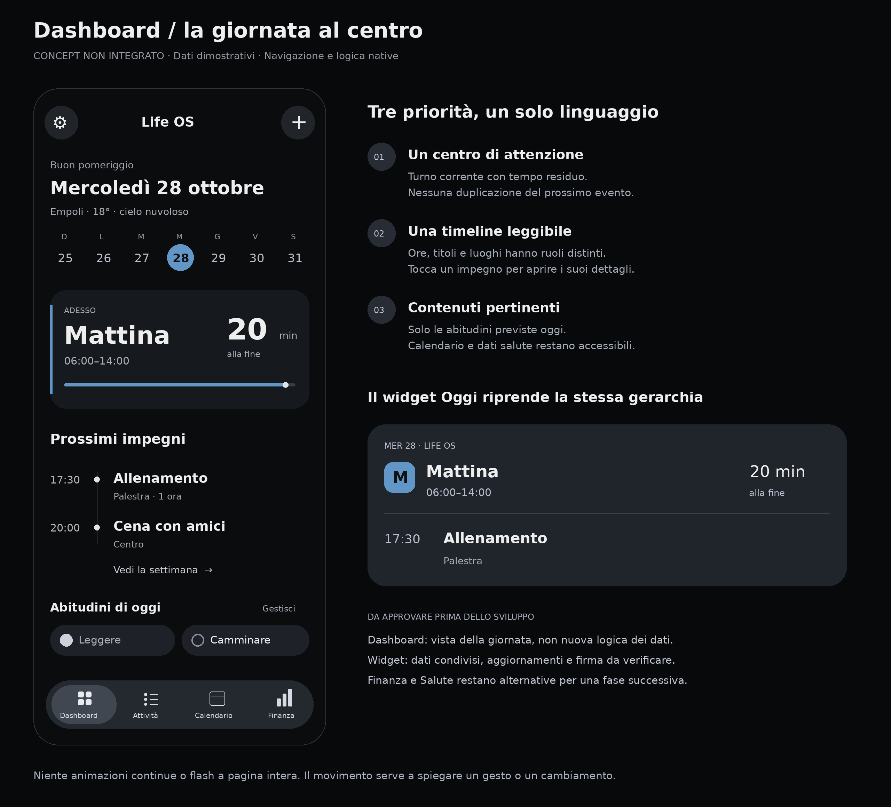
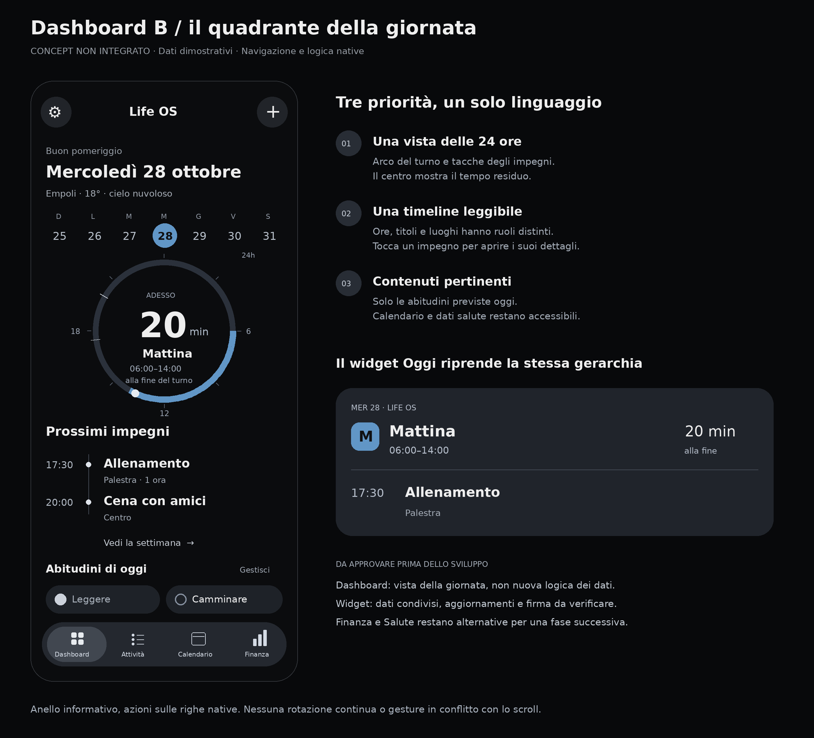
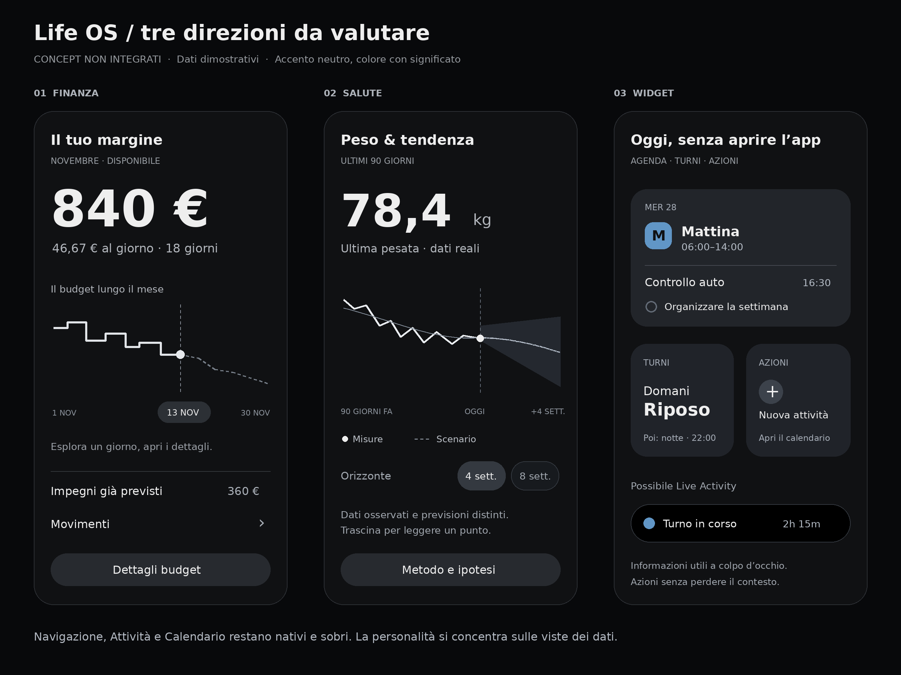

# Life OS — stabilità, widget e direzioni visive

## Correzioni della build 65 — verificate su simulatore

- Rimossa la dissolvenza di ingresso che portava l’intera destinazione a opacità zero dopo il cambio scheda. TabView e NavigationStack restano responsabili delle transizioni native e conservano identità e stato.
- Il titolo dell’attività usa NativeDesign.body sia in lettura sia in editing. Il tasto di chiusura passa accanto ai comandi, senza ridurre la larghezza disponibile per il testo. La riga mantiene la stessa colonna del cerchio, lo stesso allineamento e nessuna dissolvenza sul titolo.
- Eliminata l’inizializzazione del testo vuoto seguita da onAppear. I campi leggono subito il record o la bozza già presente.
- Le bozze stanno nella schermata per ID dell’attività: passaggio fra schede, cambio categoria e riciclo delle righe non le eliminano. Una modifica non salvata resta riconoscibile. Alla chiusura si può salvare, scartare oppure continuare a modificare; il salvataggio usa la persistenza e la coda esistenti. Il testo viene riallineato al valore effettivamente salvato e il salvataggio nell’editor dettagli aggiorna anche la bozza inline.
- Comando esplicito Nascondi tastiera nella barra della tastiera; la bozza non viene salvata o scartata solo per tornare alla navigazione.
- Note e scadenza restano presenti nelle due modalità. Nessuna nuova dipendenza, nessuna modifica al Worker.

## Prima direzione scelta: Dashboard — proposta non implementata

### A — Focus e timeline

### B — Quadrante della giornata

La variante B è la proposta più non convenzionale: un quadrante delle 24 ore mostra il tratto del turno e le tacche degli appuntamenti. Il centro mostra il tempo residuo del turno. L’anello è informativo; le azioni restano sulle righe native con target di almeno 44 punti. Nessuna rotazione continua, nessuna nuova gesture che interferisca con lo scroll. Su riposo/ferie o dati mancanti il contenuto centrale cambia significato senza inventare un turno o tempo residuo. Con molti appuntamenti, la lista mantiene tutti i dettagli e i segni vicini si raggruppano.

La priorità concordata per il concept è la Dashboard: giornata e prossimi impegni. Un blocco Adesso mostra il turno corrente e il tempo residuo; segue una timeline degli appuntamenti e delle abitudini previste oggi. La mini settimana continua ad aprire il giorno nel calendario. Salute e dettagli restano accessibili scorrendo e non vengono eliminati.

La timeline usa eventi reali del calendario, non trasforma ogni attività generica in appuntamento. La logica Attivo/In attesa/Completate rimane invariata. Nessun nuovo riepilogo duplica il titolo del prossimo evento in più punti. Il caso riposo/ferie non mostra un conto alla rovescia di lavoro inesistente; in assenza di impegni la vista mostra uno stato vuoto utile, non dati inventati.

## Alternative per fasi successive — non implementate

L’immagine è un wireframe di confronto, non una schermata della nuova IPA. Tutti gli importi, le misure e gli appuntamenti sono esempi.

| Sezione | Proposta | Interazione utile | Vincoli |
| --- | --- | --- | --- |
| Finanza | Budget rappresentato lungo il mese, con valore principale unico e punto di lettura selezionato | Trascinare per leggere un giorno; aprire movimenti e vincoli che spiegano il valore | Distinguere dato osservato e stima; mantenere il modello finanziario attuale; nascondere anche il grafico in modalità privacy |
| Salute | Grafico centrale che unisce misure, tendenza e scenario, visivamente distinti | Selezione di un punto e dell’orizzonte; accesso al metodo e alle ipotesi | Nessuna previsione mostrata come certezza; dati HealthKit distinti dalle simulazioni; i controlli di scenario non registrano nuove misure |

Priorità scelta: Dashboard. Finanza e Salute rimangono alternative per una fase successiva, conservando navigazione, Attività e Calendario sobri. Accento platino, tipografia forte, colore limitato ai significati già presenti. Animare soltanto le parti che cambiano dopo un gesto; niente flash dell’intera schermata, gradienti in movimento, motori grafici aggiuntivi o loop permanenti.

## Widget: situazione attuale

L’estensione attuale contiene un widget di scorciatoie, con getTimeline a policy never: non legge attività, eventi, turni o budget. Gli App Intents esistenti aprono l’app per preparare un’attività o registrare un peso; non sono una base già pronta per completare elementi in background dal widget.

Le entitlements attuali dell’app non dichiarano un App Group. Prima di implementare widget con dati locali va verificato che il profilo usato per firmare l’IPA consenta lo stesso App Group per app ed estensione. Aggiungere soltanto una stringa alle entitlements non dimostra che la firma lo supporti.

## Sequenza consigliata

1. **Turni** — piccolo/medio: oggi, domani e settimana, colori dei turni coerenti, apertura del giorno nel calendario. Informazione prevedibile, utile anche senza aprire l’app.
2. **Oggi** — medio/grande: turno, prossimo appuntamento e poche attività pertinenti, rispettando la logica Attivo/In attesa. Mostrare aggiornamento/scadenza della copia locale, senza presentare dati vecchi come attuali.
3. **Interazioni** — completare un’attività o un’abitudine attraverso App Intent, con conferma locale persistente e sincronizzazione recuperabile. Nessuna scrittura concorrente e indipendente dell’archivio principale; riutilizzare il contratto della coda dell’app e preservare ID e occorrenza. Distinguere modifica salvata localmente e sincronizzata.
4. **Budget**, opzionale — importo disponibile e quota giornaliera, configurabili, con privacy esplicita. Non condividere l’intero archivio finanziario con il widget.
5. **Live Activity del turno**, opzionale — stato durante il turno e conto alla rovescia, avviata per un periodo utile, non un widget sempre animato.

Una sola estensione WidgetBundle può offrire più configurazioni. L’app esporterebbe una snapshot ridotta e versionata nel contenitore condiviso: soltanto i dati necessari, nessuna password o copia integrale dell’archivio. L’estensione leggerebbe quella snapshot. Le timeline coprirebbero in anticipo mezzanotte e inizio/fine turno; l’app richiederebbe un aggiornamento quando cambia un dato pertinente. WidgetKit decide quando concedere i refresh: nessuna promessa di aggiornamento continuo o ogni secondo tramite richieste di rete.

L’interattività richiede un progetto di persistenza tra processi prima dello sviluppo: la sola scrittura atomica di un JSON condiviso non protegge da aggiornamenti persi con due scrittori. Il widget non deve costruire un secondo NativeStore isolato e dichiarare una falsa sincronizzazione.

## Fonti Apple consultate

- [Developing a WidgetKit strategy](https://developer.apple.com/documentation/widgetkit/developing-a-widgetkit-strategy): dati condivisi, App Groups, interazione tramite App Intents e privacy.
- [Keeping a widget up to date](https://developer.apple.com/documentation/widgetkit/keeping-a-widget-up-to-date): timeline, budget e aggiornamenti pianificati. I refresh sono controllati dal sistema.
- [Displaying dynamic dates in widgets](https://developer.apple.com/documentation/widgetkit/displaying-dynamic-dates): conto alla rovescia di sistema senza ricaricare il widget a ogni secondo.
- [WidgetCenter](https://developer.apple.com/documentation/widgetkit/widgetcenter): richiedere il ricaricamento delle timeline quando cambiano i dati.

## Verifiche della correzione

Parsing Swift e controllo design system superati. [CI Apple riuscita](https://github.com/azeroualit-cloud/LifeOS/actions/runs/40649946337) sulla revisione `467b56c96897dec345284e6cad6d4ac80cf6b260`: 175 test unitari e 11 esecuzioni UI (2 sul simulatore principale iPhone 17 Pro, 9 sul compatto iPhone SE di terza generazione), zero errori. Verificati geometria del titolo e del cerchio, bozza e salvataggio attraverso cambi scheda, editor dettagli, cambi scheda ripetuti e regressioni compatte. Confrontate anche le schermate prima e durante la modifica.

Build Release 0.10.4 (65), app e widget, archivio IPA integro. SHA-256: `4ba9524ed807c685c164dc0c82b455354dfbc461447f754ff2abe22052fb65c6`. IPA non firmata, da firmare con il proprio servizio. Nessuna verifica fisica su iPhone 15 Pro/iOS 27: CI con Xcode 26.3 e simulatore iOS 26.2. I test UI confermano geometria, stato e raggiungibilità; non certificano FPS o assenza assoluta di scatti sul dispositivo.

I concept grafici e i widget avanzati sono soltanto proposte: non sono stati inseriti nell’app della build 65. Worker invariato; nessun deployment del backend necessario per queste correzioni.
