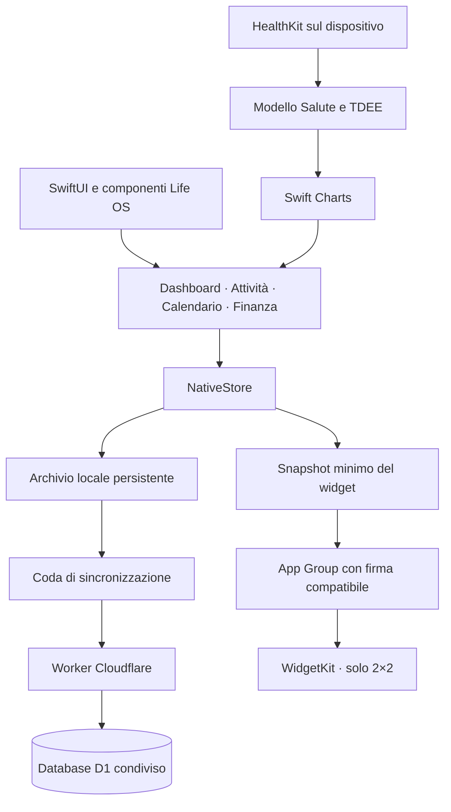

# Revisione 70 — Calendario, widget e coerenza nativa

Versione **0.10.9 build 70**, 30 ottobre 2026. [Scarica direttamente l’IPA](https://github.com/azeroualit-cloud/LifeOS/releases/download/ios-0.10.9-build70/LifeOS-70.ipa) · [build e test Apple](https://github.com/azeroualit-cloud/LifeOS/actions/runs/41134083093) · [distribuzione e controllo API Cloudflare](https://github.com/azeroualit-cloud/LifeOS/actions/runs/41138923274).

Sorgente nativo verificato: `32687ab8bf1a13afca078df49c5b9d5bc9da9aaa`. SHA-256 IPA: `dca5df9c93f51c908089044e3099e22c28cf15a63fdd5af9144fa83e76d822d7`. Aggiornare tramite Signulous sopra l’app esistente, senza disinstallarla, e aprirla per esportare i dati del widget.

## Modifiche

- Dashboard: i giorni precedenti a oggi sono all’80% di opacità. Oggi e giorni futuri conservano piena visibilità, compresi weekend e giorni del mese successivo. Il calendario mensile mantiene le proprie regole separate.
- Calendario: mesi continui nella parte superiore, con barra dei comandi e giorni della settimana fissi; riquadro del giorno separato e fisso nella parte inferiore. I mesi restano scorrevoli mentre la palette è aperta; il dettaglio del giorno selezionato resta nel riquadro inferiore. Accesso dalla scheda e ritorno dal background ripristinano oggi; l’apertura di un giorno dalla Dashboard mantiene invece il giorno richiesto.
- Turni: palette compatta, simbolo/iniziale e orari abbreviati; una sola riga con scorrimento quando necessario. Barra del turno attivo nel relativo colore, segmenti proporzionali di due ore e segmento finale parziale. La microanimazione consuma una sola volta l’ultimo segmento completato all’apertura durante il turno; stato conservato fra avvii e Riduci movimento rispettato. Nessuna barra grigia negli stati inattivi.
- Finanza: icone bianche SF Symbols, effetto Liquid Glass Apple sui pulsanti dove disponibile. Movimenti ordinati per istante di inserimento UTC, senza mostrare l’ora; per i dati storici senza timestamp usa l’ordine di inserimento originale, senza inventare date.
- Widget: solo formato piccolo 2×2, turni dei sette giorni da oggi come informazione principale, riepiloghi compatti di abitudini/attività/eventi e pulsante + che apre l’editor unico. Le dimensioni ridotte nascondono il titolo aggiuntivo quando manca spazio. Conteggi visivi limitati a 9+, conteggi completi per VoiceOver. Nessun saldo, dato Salute o credenziale esportati.
- Widget offline: cache atomica minima in App Group, data originale di aggiornamento separata dall’istante di esportazione. Uno snapshot vecchio resta dichiarato vecchio anche riaprendo offline. Timeline giornaliera con aggiornamento richiesto al sistema e stato esplicito quando i dati non sono disponibili.
- Salute: numeri e tracciato/punti del peso grigi; mini anteprima senza dettagli aggiuntivi conservata. Barre calorie grigie salvo oggi nell’accento, estremità superiori arrotondate e basi dritte. TDEE calibrato sui 30 giorni precedenti l’ultima pesata completa, escludendo come ancora la pesata di oggi; stime derivate dallo stesso TDEE.
- Agenda: conservati l’editor unico task/evento senza priorità, le date affiancate, descrizione e metadati esistenti; impegni settimanali raggruppati per giorno nello stile delle abitudini con completamento diretto dalla Dashboard. Salvataggio locale persistente immediato e sincronizzazione idempotente in background.

## Architettura

**App: Swift. Backend: JavaScript su Cloudflare Workers e D1.** La grafica usa SwiftUI, Swift Charts, SF Symbols, HealthKit e WidgetKit; componenti e token Life OS sopra le API Apple. Nessun framework grafico terzo aggiunto. `native-next/` resta l’overlay canonico sulla build 60 fissata nel workflow. La cartella `Shared/` contiene soltanto modello minimo, palette e vista del widget riusati da app/estensione e anteprima di test.

| Area | Base Apple | Personalizzazione Life OS |
| --- | --- | --- |
| Layout e navigazione | SwiftUI | Token, spaziature e componenti riusabili |
| Grafici | Swift Charts | Stile delle barre e presentazione; modello TDEE separato |
| Icone e vetro | SF Symbols e Liquid Glass | Scelta dei simboli, colori e forme |
| Peso e calorie | HealthKit | Calibrazione e stime locali |
| Widget | WidgetKit e App Groups | Snapshot minimo, sette giorni e riepiloghi |
| Dati e rete | Foundation, SQLite e URLSession | Archivio, coda persistente e replay idempotenti |

## Backend

Il metadato di creazione vive in una tabella dedicata collegata all’identificatore originale del movimento. Il trigger di inserimento scrive solo quella tabella: nessun UPDATE del movimento per stampare il tempo, nessuna modifica a importi/date storiche e nessuna attivazione indiretta dei trigger finanziari di aggiornamento esistenti. Timestamp immutabile, cancellazione propagata e batch atomici verificati. Proiezione API estesa in coda, conservando gli indici delle categorie finanziarie.

**Distribuiti e verificati entrambi i Worker `lifeos` e `lifeos-native-test` nella [procedura 41138923274](https://github.com/azeroualit-cloud/LifeOS/actions/runs/41138923274), commit `0e87aeabe559fffe62a5c161e39a0a27bbc439f4`.** Il gate ha confermato il successo della build Apple e l’identità del sorgente nativo prima del caricamento. Il controllo autenticato di `getFinanceData` ha verificato campo `created_at`, ordinamento, tabella e trigger; i trigger preesistenti hanno mantenuto le stesse impronte.

Audit preliminare in sola lettura di sorgenti, schema e trigger live; distribuzione separata subordinata al successo della build Apple dello stesso sorgente nativo. Moduli precedenti mantenuti per rollback anche se fallisce il controllo API dopo il caricamento. Nessun record bancario di prova creato; codice live, query, risposte e credenziali non pubblicati nei log.

## Verifiche

- **199 test unitari** e **33 esecuzioni UI** passati, zero fallimenti: 5 mirate e 6 regressioni sul simulatore principale, 22 su iPhone SE 3; 24 metodi UI distinti.
- Verificati ritorno a oggi dalla scheda e dal background, giorno richiesto dalla Dashboard, separazione dei due riquadri, selezione ripetuta, pennello e annullamento, minimi di tocco, editor unico, completamento diretto e viste Salute nei due temi e con testo accessibile. Le anteprime del widget riusano la vista reale a 170 e 141 punti.
- Backend: 7 casi su timestamp/migrazione, 17 regressioni finanziarie sul Worker generato, 11 test attività, 3 verifiche di integrazione sul Worker reale generato e 10 test Python sulle trasformazioni/distribuzioni. Audit e contratto live passati senza creare movimenti di prova.
- IPA scaricata dal collegamento pubblico: checksum e CRC ZIP corretti; bundle/versioni, estensione unica WidgetKit, schema `lifeos`, binari arm64 e piattaforma iOS reale di app ed estensione verificati anche nei comandi Mach-O. Dimensione: **1.460.433 byte**.
- Per la microanimazione sono verificati proporzioni, DST, idoneità all’attivazione e consumo persistente una volta per sezione. Le schermate statiche non certificano la percezione dell’animazione sul telefono.

## Firma e limiti

L’IPA è per rifirma Signulous. La condivisione reale dei dati del widget richiede che la firma mantenga l’estensione e abiliti lo stesso App Group **`group.com.nas.lifeos`** nei profili firmati di app ed estensione. Simulatori e proiezione dati non certificano il provisioning del telefono. In assenza del gruppo l’app segnala la condizione e il widget chiede di collegare i dati; non mostra conteggi fittizi. Nessuna prova fisica o firma Signulous eseguita qui. La richiesta di aggiornamento WidgetKit resta soggetta alla pianificazione iOS.

Riferimenti Apple: [collegamenti del widget, incluso il formato piccolo](https://developer.apple.com/documentation/widgetkit/linking-to-specific-app-scenes-from-your-widget-or-live-activity) · [configurazione App Groups](https://developer.apple.com/documentation/xcode/configuring-app-groups).
