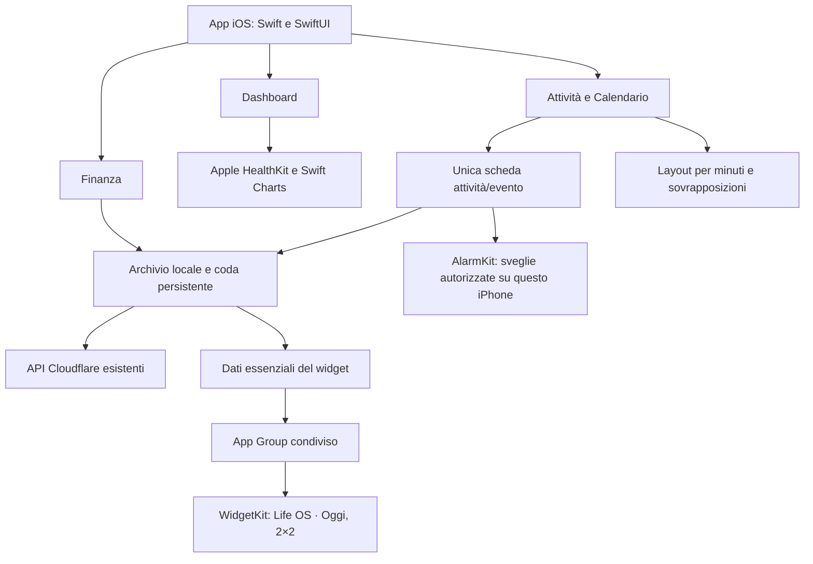

# Revisione 71 — in verifica

Base: build 70, sorgente `native-next`, Swift e SwiftUI; Charts per Salute, WidgetKit per il widget, AlarmKit per le sveglie urgenti. Nessun nuovo framework esterno. Icona attuale conservata su scelta dell’utente.

## Struttura attuale

La base è nativa Apple. Sono specifici di Life OS i componenti composti con SwiftUI, i colori dei turni, il modello dei dati e il layout degli impegni. Liquid Glass, fogli, selettori, navigazione, grafici e integrazioni di sistema usano i framework Apple. Non vengono aggiunti altri framework grafici.

## Contratto UI

- Dashboard: solo data nell’intestazione; turno e progresso conservati. Peso e calorie usa arancione Salute per valori e barra odierna, grigio per storico e linea peso. Settimana: giorni passati all’80%, giorni futuri visibili anche nel mese successivo.
- Attività: tocco sul titolo → scheda nativa dal basso; completamento resta indipendente nella lista. Titolo/descrizione, inizio e scadenza affiancati, selettore data aperto dal primo tocco e rimozione con ×. Orari direttamente sotto le date, poi categoria e luogo. Attesa, completamento, eliminazione e ricorrenze restano disponibili.
- Calendario: mese continuo a tutta altezza, giorni ampi e numeri semibold. Tocco → giorno con settimana superiore e griglia oraria posizionata per minuto e durata, con colonne per sovrapposizioni e attività di tutto il giorno fisse sopra le ore. Ritorno al mese; accessi normali e riapertura riportano a oggi. Accesso esplicito dalla Dashboard apre il giorno richiesto. Nessuna esportazione Apple nella scheda Calendario; resta in Impostazioni.
- Dipingi: riferimento Supershift scelto dall’utente; palette orizzontale Liquid Glass nativo su iOS 26 (materiale di sistema sulle versioni precedenti). Il salvataggio continua a usare la coda locale persistente; gli aggiornamenti di soli turni non ricostruiscono l’indice eventi di tutti i mesi. La posizione visibile viene osservata senza riscrivere continuamente l’offset dello scorrimento; i salti sono riservati ai comandi espliciti e all’estensione della finestra dei mesi.
- Finanza: struttura aperta dell’allegato, titolo e pulsanti sulla stessa riga, importi allineati a sinistra, conto con saldo a destra, Budget/Analisi in pillole, movimenti con icona e divisori. Nuovo movimento dal +; ulteriori azioni nel menu. Le icone sono simboli semplici monocromatici, senza immagini generate.

## Sveglie urgenti

Prima integrazione nativa AlarmKit, solo iOS 26+, per eventi singoli futuri con orario. Consenso distinto dalle notifiche; nessun accesso ad AlarmKit per un’attività senza sveglia. Opzione locale a questo iPhone, non sincronizzata al server; serie ricorrenti escluse esplicitamente. UUID stabile, modifica della stessa sveglia, cancellazione dopo completamento/eliminazione e riconciliazione dei record caricati. Un mese non caricato non equivale a un evento eliminato. Gli errori di autorizzazione/programmazione/cancellazione sono visibili. La prova del suono su iPhone reale resta necessaria.

## Widget

La vecchia identità `LifeOSQuickActions` viene sostituita da `LifeOSOverview`, nome galleria **Life OS · Oggi**, una sola famiglia 2×2. Dopo installazione rimuovere il widget con i vecchi pulsanti e aggiungere quello nuovo. Il cambio rende distinguibile un’estensione vecchia da quella aggiornata. Se il nuovo nome manca anche in galleria, verificare che il servizio di firma conservi l’estensione dell’IPA aggiornata. App ed estensione richiedono `group.com.nas.lifeos`. L’app espone stato e aggiornamento manuale; anche in assenza di App Group richiede il refresh della vista per non lasciare la precedente cache. La firma effettiva del servizio esterno non è verificabile dal simulatore.

## Verifiche

Stato provvisorio: sintassi Swift e design system controllati localmente; compilazione Apple, test e QA visivo da completare prima di pubblicare l’IPA 71. Nessuna modifica backend necessaria per questo incremento; i Worker della build 70 restano la base attuale.
