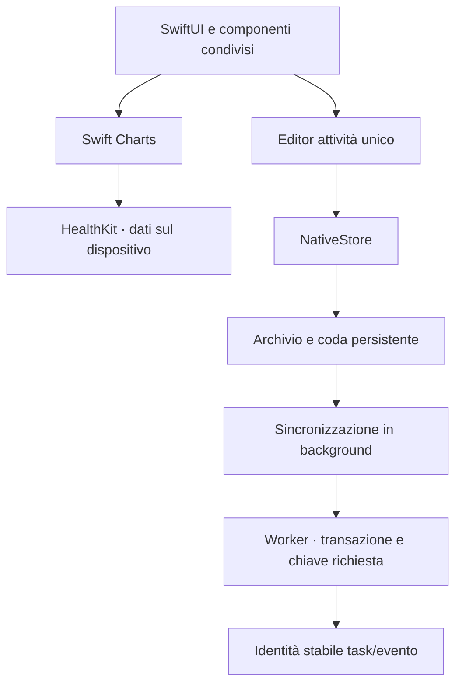

# Life OS — standardizzazione nativa, revisione 68

Base: build 60 fissata a `02c2c089841833a67fc9a223b367710edf7e37b9`, con overlay completo della 67 (`d3205b59d6df2ef9267260dcbee15e22bf29271a`). Le modifiche conservano le funzioni recenti di Salute, agenda, modifica inline e instradamento spese. La vecchia build 53 non è la baseline di questo intervento.

SwiftUI gestisce navigazione, form, date e controlli; Swift Charts disegna i grafici; SF Symbols fornisce le icone; HealthKit legge peso/calorie e conserva le autorizzazioni già esistenti. NativeDesign centralizza gli stili. Il nuovo NativeActivityEditor sostituisce i due editor separati; i wrapper TaskEditor/EventEditor conservano i punti di ingresso esistenti.

## Comportamenti

Titolo, descrizione, inizio/scadenza affiancati, categoria e luogo. Data iniziale facoltativa: aggiungerla pianifica l’attività nel calendario; rimuoverla la riporta nella lista. Orari e ricorrenza restano disponibili; nessuna priorità. L’identità pubblica rimane stabile attraverso le conversioni, mentre le due tabelle esistenti restano compatibili con le API precedenti. I campi aggiuntivi sono conservati in metadati associati all’identità; divisione esplicita delle serie e spostamento di categoria conservano questi collegamenti. Il limite condiviso di 160 unità UTF-16 mantiene compatibili i titoli delle attività precedenti senza troncarli; il controllo Unicode avviene prima dell’accodamento. Per serie con occorrenze già segnate la modifica strutturale richiede il flusso esplicito «Modifica da questa occorrenza»: una conversione diretta non cancella lo storico.

Salvataggio: validazione locale, scrittura atomica dell’archivio con coda, aggiornamento UI e chiusura editor. Invio successivo con UUID persistente; replay identici producono una sola registrazione, contenuti diversi con la stessa chiave sono rifiutati. Gli invii della stessa attività rispettano l’ordine; le modifiche locali successive restano visibili durante la sincronizzazione. La conferma locale è distinta dalla conferma server. Un server precedente non viene presentato come compatibile: occorre `capabilities.unifiedActivities = 1`.

Agenda settimanale senza card: data/ora e separatore, titolo rientrato sotto. Giorni passati attenuati. Palette turni in una riga: icona, iniziale, orari brevi, scorrimento orizzontale quando necessario, nomi completi per VoiceOver.

Salute: metriche a sinistra, grafico a destra. Grigio di sistema per barre storiche e peso; barra di oggi in accento. Solo gli angoli superiori delle barre sono leggermente arrotondati tramite ChartContent.clipShape e UnevenRoundedRectangle. La calibrazione TDEE usa esclusivamente la finestra di 30 giorni che termina all’ultima pesata antecedente a oggi; calorie del giorno finale escluse, mantenendo copertura minima, robustezza e controlli preesistenti sui dati insufficienti. Tutte le simulazioni continuano a usare la stessa stima. Nessun dato HealthKit viene inviato al server.

## Verifica e distribuzione

Test SQLite del servizio: replay, conversioni reversibili, campi conservati, eccezioni ricorrenti, completamento offline, concorrenza con eliminazione, riapertura, titoli lunghi e rollback. Test dell’effettivo Worker generato: migrazioni, RPC, lettura arricchita, conversione e completamento. Regressioni finanziarie conservate. Test nativi: coda senza attese di rete e riapertura, identità locale e validazione, finestra TDEE, editor, salute e palette nel simulatore principale e compatto.

Il Worker 68 viene generato dalla copia recuperata della 67. La distribuzione non la sovrascrive sul server: scarica il codice live in memoria, applica solo sostituzioni con contesto univoco, conserva moduli estranei, binding e segreti, controlla il database atteso, verifica l’upload e ripristina i moduli originali in caso di errore. L’audit iniziale è in sola lettura; la distribuzione è separata dalla build e viene avviata esplicitamente dopo i test Apple e il consenso specifico sui Worker live.

## Consegna verificata — 30 ottobre 2026, 0.10.7 build 68

[IPA per Signulous](https://github.com/azeroualit-cloud/LifeOS/actions/runs/41052957803/artifacts/12976114405) · [build Apple](https://github.com/azeroualit-cloud/LifeOS/actions/runs/41052957803) · [verifica indipendente IPA](https://github.com/azeroualit-cloud/LifeOS/actions/runs/41056586423) · [distribuzione e controllo API live](https://github.com/azeroualit-cloud/LifeOS/actions/runs/41057450159).

Superati 191 test unitari nativi e 25 esecuzioni UI (10 sul simulatore principale, 15 sul compatto; 18 metodi UI distinti), zero fallimenti. Backend: 11 test attività, 3 verifiche di integrazione sul Worker generato, 17 regressioni finanziarie e 4 test del deploy. Verificate integrità ZIP, checksum, bundle/versione, piattaforma iPhoneOS e binario arm64 dell’IPA Release. Firma Signulous e prova fisica non eseguite.

Sorgente app verificato: `642507c893321bcc78e14613ee9d76dfa62816c0`. Backend finale: `14044ba2a645a8334e2fd1176464cb1ed92d0f9f`; workflow di distribuzione verificato: `f53f3e1b9141a4bd9f0c87fa2b743c1b0bf70cc1`. I commit successivi alla build Apple modificano backend, procedure e documentazione, senza modificare il sorgente nativo verificato.

Dopo l’autorizzazione esplicita dell’utente, aggiornati e verificati entrambi i Worker `lifeos` e `lifeos-native-test`, conservando moduli estranei, autenticazione, binding e segreti. Accesso autenticato, lettura reale, capability delle attività unificate e rifiuto di un titolo vuoto verificati: nessuna attività di prova creata e nessun dato privato pubblicato nei log.

IPA SHA-256: `bb2cb3085f3f358b744d9566d2aa79b0f062936b5c0fb03bc8064d9b1f000670`. Artefatto disponibile fino al 6 novembre 2026, 12:30 UTC. Estrarre `LifeOS-unsigned.ipa` dal pacchetto e aggiornare tramite Signulous senza disinstallare l’app.

